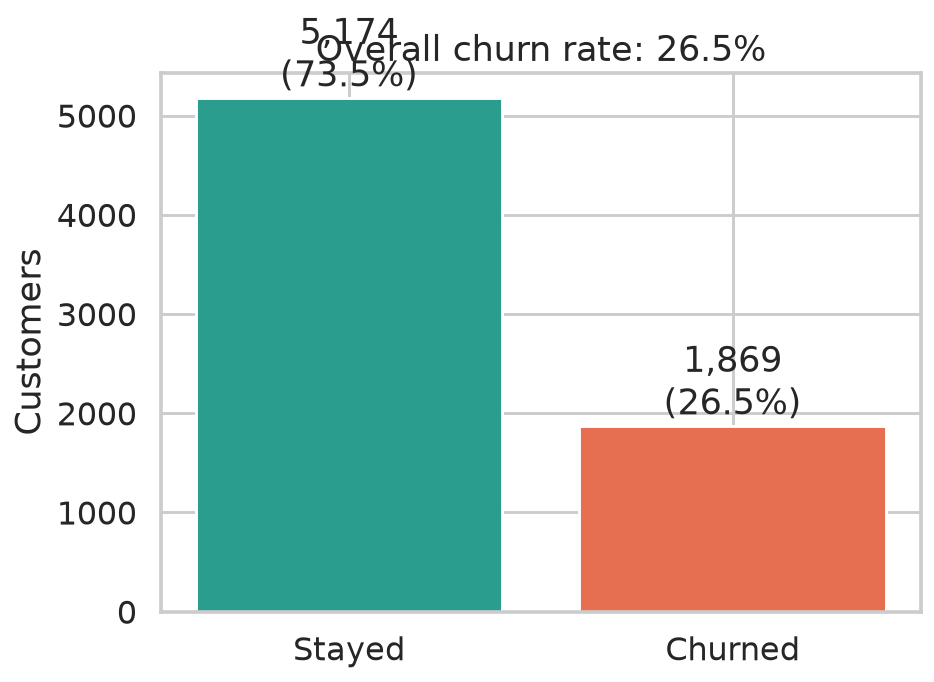
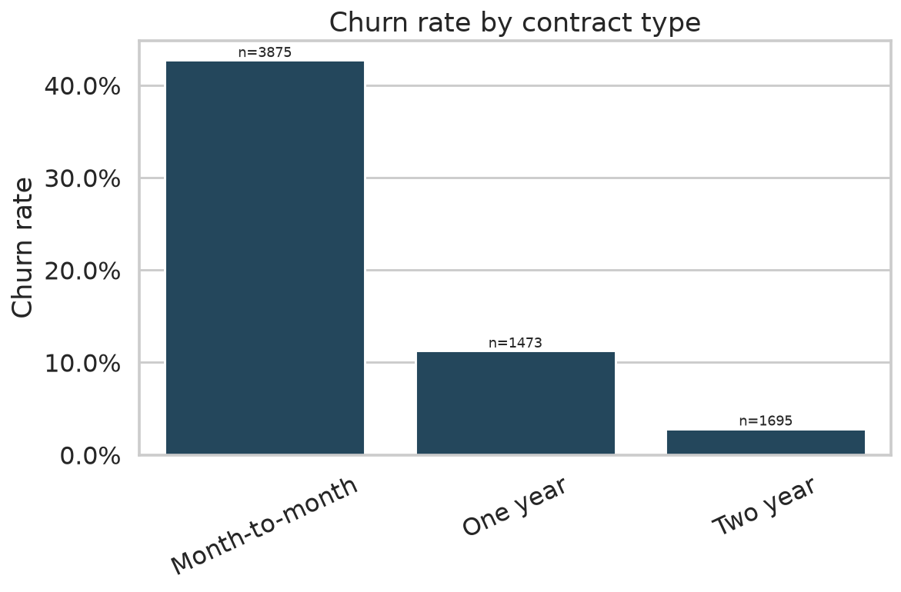
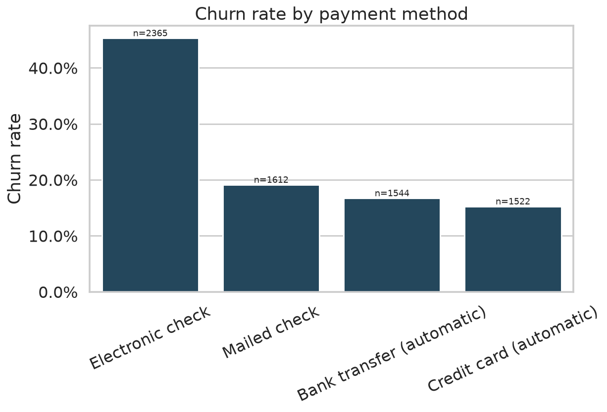
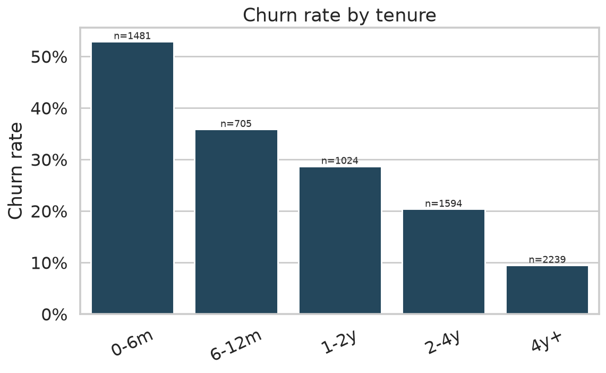
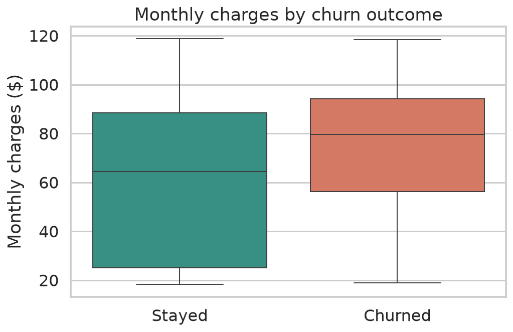
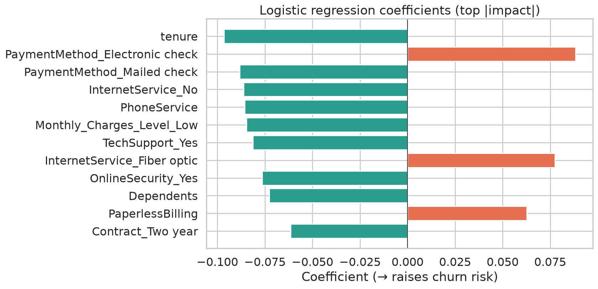
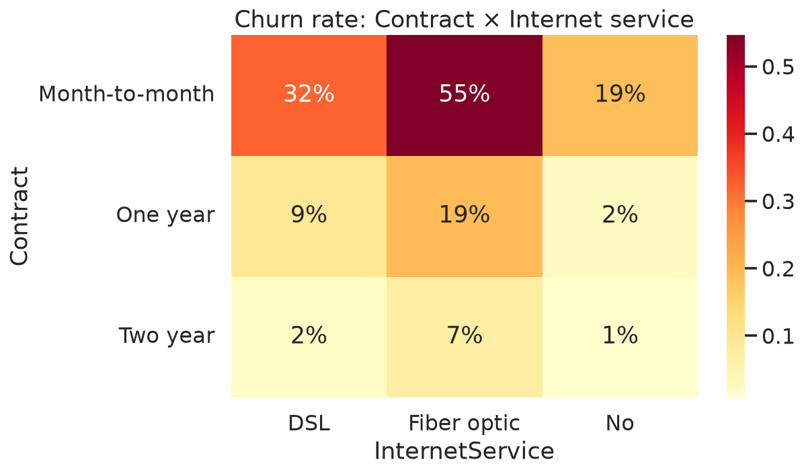

# Customer Churn Analysis — Telco Retention Drivers

**Who is likely to leave, why, and where to intervene first**

[](https://www.python.org/)
[](https://scikit-learn.org/)
[](https://www.tableau.com/)
[](https://opensource.org/licenses/MIT)

---

## Overview

Portfolio project on the classic **Telco Customer Churn** dataset (~7k customers):

1. Clean / feature-engineer customer, contract, and billing attributes  
2. Fit a **logistic regression** and inspect coefficients (`churn_feature_importance.csv`)  
3. Visualize risk segments in **Tableau** (`.twbx`)  
4. Reproduce key charts in Python for GitHub storytelling  

Business question: *Which customers churn, which levers matter, and where should retention budget go?*

---

## Key insights

Full write-up: [`outputs/insights.md`](outputs/insights.md)

### Charts

| | |
|:--|:--|
|  |  |
|  |  |
|  |  |



---

## Quickstart

```bash
git clone https://github.com/Nicolenki7/Customer-Churn-Project.git
cd Customer-Churn-Project

python -m venv .venv && source .venv/bin/activate
pip install -r requirements.txt
python src/churn_analysis.py
```

---

## Repo layout

```
telco_churn_feature_engineered_for_tableau.csv   # modeling / BI table
churn_feature_importance.csv                     # logistic coefficients
Customer_Churn_Python+SQlite.ipynb               # original notebook
Customer Churn Analysis.twbx                     # Tableau workbook
src/churn_analysis.py                            # reproducible charts
outputs/figures/ · outputs/insights.md
```

---

## Method notes

- Target: `Churn` (1 = left, 0 = stayed)  
- Model story: logistic regression coefficients (positive ⇒ higher churn odds)  
- Strong risk pattern in this data: **month-to-month + electronic check + early tenure**  
- Protective patterns: longer contracts, tech support / online security  

> Honest scope: this is an **analytics & storytelling** portfolio piece (Python + Tableau). It is not a production scoring service.

---

## Author

**Nicolas Zalazar** — Data Analyst · Aspiring Data Engineer · Mallorca, Spain  
GitHub: [@Nicolenki7](https://github.com/Nicolenki7)

---

## License

MIT for analysis code. Dataset follows its original public license (IBM Telco / Kaggle-style churn).
