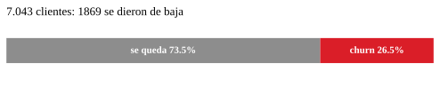
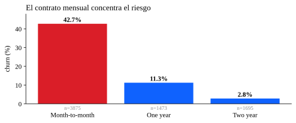
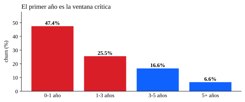
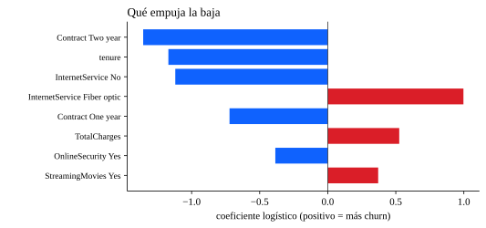

# Customer Churn — Telco Retention Drivers

**Who is about to leave, why, and where the retention budget should go first**

[](https://www.python.org/)
[](https://scikit-learn.org/)
[](https://www.tableau.com/)
[](https://opensource.org/licenses/MIT)

---

## The business question

A telecom operator is losing **one customer in four**. Winning a new one costs five to seven times more than keeping the one already paying, so the question that matters is not *how many* people leave but **who is going to leave, when, and why** — and which of those levers is actually within reach.

This project answers it in three steps: how churn is distributed across segments, which attributes push the decision, and where a retention action would touch the most revenue.



---

## What the data says

### The contract is the lever with the most volume



Month-to-month customers churn at **42.7%**, against 11.3% on annual and 2.8% on two-year contracts. With **3,875 customers** on the monthly plan, moving even a small share of them to an annual contract is the highest-leverage action in this dataset — not because the rate is surprising, but because of how much of the base sits there.

### The first year decides almost everything



**47.4%** of customers in their first year leave, and the rate falls to 6.6% past the fifth. Onboarding is not a nice-to-have: it is where the churn is decided.

### Who leaves also pays more

| | Churned | Retained |
|:--|--:|--:|
| Monthly charges (avg) | 74.44 | 61.27 |
| Tenure in months (avg) | 18.0 | 37.6 |

The customer who leaves is paying **more** and has been there **half as long**. Price is not pushing people out on its own; the combination of a high bill and a short relationship is.

### What pushes the exit



Top coefficients from the logistic regression, with their odds ratios (values below 1 reduce the odds of churn, values above 1 increase them):

| Attribute | Coefficient | Odds ratio | Reading |
|:--|--:|--:|:--|
| Contract: two year | −1.36 | 0.26 | Strongest protection in the data |
| Tenure | −1.17 | 0.31 | Every extra month lowers the risk |
| Internet service: none | −1.12 | 0.33 | No internet, no reason to churn |
| Internet service: fiber optic | +1.00 | 2.71 | Highest-risk product |
| Contract: one year | −0.72 | 0.49 | Half the risk of monthly |
| Total charges | +0.53 | 1.69 | Proxy for high-value, unhappy customers |
| Online security: yes | −0.39 | 0.68 | Add-on services retain |
| Streaming movies: yes | +0.37 | 1.45 | Entertainment subscribers are more volatile |

Full list: [`outputs/churn_feature_importance.csv`](outputs/churn_feature_importance.csv).

**Model performance:** AUC **0.846**, accuracy 0.750 on a 25% hold-out (5,282 train / 1,761 test). Reported as AUC and not just accuracy because the base is imbalanced at 26.5%: a model that always answers "stays" would already be right 73.5% of the time.

---

## Reproduce it

```bash
git clone https://github.com/Nicolenki7/Customer-Churn-Project.git
cd Customer-Churn-Project

python -m venv .venv && source .venv/bin/activate
pip install -r requirements.txt

python src/download_data.py    # ~1 MB, verified against its sha256
python src/churn_pipeline.py   # regenerates the CSVs and every SVG in docs/img
```

The dataset is **not committed**: it is one HTTP call away and the checksum pins it byte for byte, so nobody has to trust a copy. The same applies to the notebook — open it in Colab and the first cell downloads and verifies the data by itself.

**`sha256`** of `Telco-Customer-Churn.csv`:
`16320c9c1ec72448db59aa0a26a0b95401046bef5d02fd3aeb906448e3055e91`

---

## Repo layout

```
Customer_Churn_Python+SQlite.ipynb   notebook: cleaning, SQL, charts, model
src/download_data.py                 download + checksum verification
src/churn_pipeline.py                the whole analysis, end to end, from the CLI
src/churn_analysis.py                extended exploratory charts (PNG, seaborn)
tests/test_data_contract.py          validates every committed CSV (runs in CI)
docs/img/*.svg                        the four charts used in this README
outputs/churn_feature_importance.csv  logistic coefficients + odds ratios
outputs/insights.md                  short written summary
outputs/figures/*.png                extended figure set
Customer Churn Analysis.twbx         Tableau workbook
```

---

## Method

**Cleaning.** `TotalCharges` arrives as text; converting it reveals 11 empty values, and all 11 belong to customers with `tenure = 0` — new sign-ups with no accumulated bill yet. It is not corruption, so they are imputed to 0 instead of dropping the row: those are precisely the customers most likely to leave. `No internet service` is normalised to `No` across the six add-on services so the same category is not split in two, and `customerID` is dropped before modelling.

**Feature engineering in SQL.** The cleaned frame is loaded into an in-memory SQLite database and enriched with `CASE WHEN` to build `Seniority_Category` (tenure bands) and `Monthly_Charges_Level`. The result is exported for BI tools.

**Model.** Logistic regression with `class_weight='balanced'`, one-hot encoding with `drop='first'` to avoid collinearity, standardised numerics so coefficients are comparable, and a stratified 75/25 split with a fixed seed. Chosen for interpretability: the point is to say *which* lever moves churn, not to squeeze the last decimal of AUC.

---

## Limitations

- A single 75/25 split with `random_state=42`; no cross-validation, so the AUC carries unmeasured variance.
- The dataset has no dates: it gives a probability of churn, not a *when*.
- Coefficients are associations from one operator at one point in time. They support the method, not extrapolation to another market.
- `TotalCharges` and `MonthlyCharges` are partly collinear with tenure; the signs are stable but their magnitudes should not be read as causal effects.

## Where this would go next

Turn the probability into money: cross the cost of a retention action with customer value and keep only the cases where expected savings beat the cost. That is what turns a model into a decision — and the churn probability is already the input it needs.

---

## Author

**Nicolas Zalazar** — Data Analyst · Aspiring Data Engineer · Mallorca, Spain
GitHub: [@Nicolenki7](https://github.com/Nicolenki7)

## License

MIT for the analysis code. The dataset keeps its original public license (IBM Telco Customer Churn).
